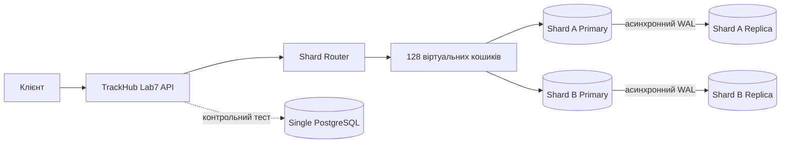
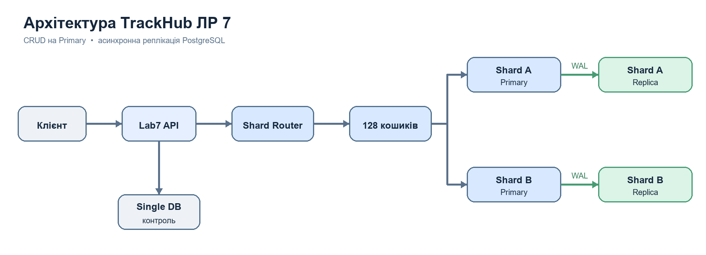
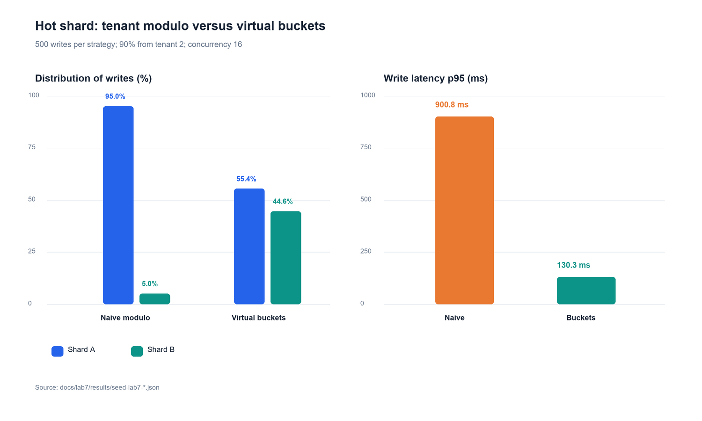
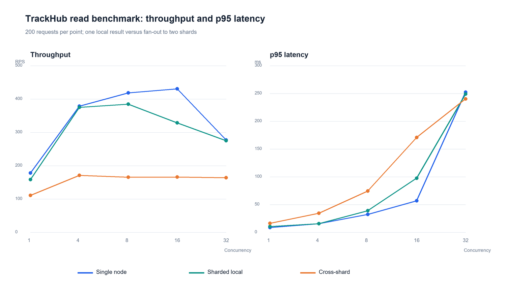

# Лабораторна робота 7 Масштабування даних TrackHub

## 2.1 Dataset і ключ шардингу

Для демонстрації обрано події завдань TrackHub (`lab7_events`). Кожна подія має `tenant_id`, `event_id`, `run_id` і `payload`. Події незалежні одна від одної, тому їх можна розподіляти між вузлами без розділення однієї транзакції створення.

Основний ключ маршрутизації складається з `tenant_id` і `event_id`. `tenant_id` зберігає контекст клієнта, а унікальний UUID події дає високу кардинальність і розподіляє записи великого клієнта. `event_id` сам по собі поганий доменний ключ: він не дозволяє ефективно відповісти на запит «усі події клієнта». Комбінований ключ теж має ціну: запит за одним `tenant_id` стає міжшардовим. Для порівняння залишено наївну стратегію `tenant_id % 2`.

Сурогатний автоінкрементний `id` сам по собі не підходить як Shard Key. Він не містить `tenant_id`, тому запит за клієнтом мусив би опитувати всі шарди або звертатися до окремого глобального індексу. При розподілі послідовних `id` за діапазонами нові записи концентрувалися б на останньому шарді. Навіть якщо `id % N` розподіляє записи рівніше, він не враховує найважливіші запити за клієнтом і змушує переносити багато записів при зміні `N`. Тому ключ обрано за контекстом доступу й кардинальністю, а не лише за зручністю Primary Key.

## 2.2 Архітектура і маршрутизація



Вихідний файл схеми: [`architecture.mmd`](architecture.mmd). API виконує CRUD лише на Primary відповідного шарду. Replica отримує WAL асинхронно та доступна для читання; автоматичного перемикання на неї при відмові Primary у цьому стенді немає. Контрольна база `single` не є реплікою шарду. Кількість подів застосунку в Kubernetes також не означає реплікацію PostgreSQL.



`docker-compose.lab7.yml` запускає два незалежні PostgreSQL-вузли, контрольну одно-вузлову базу й API. Кожна база має власний том Docker. Маршрутизатор у `lab7/sharding.py` обчислює SHA-256 від `tenant_id:event_id`, вибирає один із 128 віртуальних кошиків, а власника кошика визначає rendezvous hashing. Однаковий ключ завжди веде на той самий шард. Створення через `POST /events` та читання, зміна і видалення через `GET`, `PATCH`, `DELETE /events/{tenant_id}/{event_id}` використовують той самий маршрут. Ізоляцію перевіряють запити `SELECT count(*)` окремо до Shard A та Shard B.

Запуск:

Якщо образ `devops-web:latest` ще не зібраний, спочатку виконайте `docker compose -f docker-compose.yml build web`. Контур ЛР № 7 наслідує Python-залежності основного TrackHub.

```powershell
docker compose -f docker-compose.lab7.yml up -d --build
docker compose -f docker-compose.lab7.yml ps
curl.exe http://localhost:8010/health
```

Реплікація для обох шардів запускається окремим Compose-файлом. Скрипт додає правило доступу для потокової реплікації на Primary, створює Replica через `pg_basebackup` і показує стан `streaming`:

```powershell
powershell -NoProfile -ExecutionPolicy Bypass -File .\scripts\lab7_replication.ps1
docker compose -f docker-compose.lab7.yml -f docker-compose.lab7.replication.yml ps
docker compose -f docker-compose.lab7.yml -f docker-compose.lab7.replication.yml exec -T shard_a psql -U postgres -d lab7 -c "select application_name, state, sync_state from pg_stat_replication"
docker compose -f docker-compose.lab7.yml -f docker-compose.lab7.replication.yml exec -T shard_b psql -U postgres -d lab7 -c "select application_name, state, sync_state from pg_stat_replication"
```

На перевіреному стенді `shard_a_replica` і `shard_b_replica` мають стан `streaming`, режим `async`. Перевірка нового запису з API показала `pg_is_in_recovery() = true` та один запис з тим самим `event_id` на репліці. Пароль `postgres` у Compose використано лише для локального навчального стенда.

## 2.3 Розподіл і гарячий шард

`lab7/scenarios.py seed` генерує 90% записів для `tenant_id=2`. При `naive` усі записи цього клієнта потрапляють на Shard A і блокують один рядок лічильника записів. При `bucket` незалежні події розподіляються між кошиками і двома вузлами. Для видимого синтетичного CPU-навантаження кожен запис виконує суму `generate_series(1, 100000)` всередині транзакції; це умисна частина демонстрації, а не продуктивна бізнес-логіка. Порівняння реєструє RPS, p95/p99 та розподіл записів. CPU і пам’ять вузлів слід зняти через `docker stats` під час генерації.

```powershell
docker compose -f docker-compose.lab7.yml run --rm --no-deps lab7_api python -m lab7.scenarios seed --strategy naive --count 500 --run-id lab7-naive
docker compose -f docker-compose.lab7.yml run --rm --no-deps lab7_api python -m lab7.scenarios seed --strategy bucket --count 500 --run-id lab7-bucket
docker stats --no-stream trackhub-lab7-shard_a-1 trackhub-lab7-shard_b-1
```

Результати JSON автоматично зберігаються в `docs/lab7/results`. Поле `write_percent` дорівнює частці вставлених записів у цьому сценарії. Справжня кількість спроб запису та помилок наведена у `write_metrics`.

### Фактичний результат гарячого шарду

| Стратегія | Shard A | Shard B | Записів за секунду | p95 запису | p99 запису | Помилки |
| --- | ---: | ---: | ---: | ---: | ---: | ---: |
| Наївна `tenant_id % 2` | 475 (95%) | 25 (5%) | 47,36 | 900,85 мс | 1160,42 мс | 0% |
| 128 віртуальних кошиків | 277 (55,4%) | 223 (44,6%) | 169,78 | 130,33 мс | 159,56 мс | 0% |

Пікова вибірка `docker stats` у наївному сценарії: CPU Shard A 143,09%, Shard B 18,99%; пам’ять 71,44 і 46,93 MiB. Для кошиків: CPU 235,99% і 187,26%; пам’ять 62,92 і 59,64 MiB. Docker показує понад 100% для контейнера, коли він використовує кілька ядер. Числа є піковими з вибірок, тому не є середнім за весь тест. Сирі записи: `results/stats-naive.csv` і `results/stats-bucket.csv`.



## 2.4 Запити та транзакції між шардами

`GET /events/{tenant_id}/{event_id}` звертається до одного шарду. `GET /search?q=sample-000000&run_id=...` паралельно читає обидва шарди й об’єднує відповіді. Відповідь містить загальну затримку та затримку кожного вузла. Це дозволяє порівняти локальне читання і fan-out із тим самим одним результатом.

За однакової конкуренції 8 і 200 запитів локальне читання дало 384,73 RPS та p95 38,87 мс, а fan-out — 165,44 RPS та p95 74,30 мс. Локальний запит займає одне з’єднання й виконує один запит до PostgreSQL; fan-out одночасно займає два з’єднання, виконує два запити та потребує об’єднання відповідей в API. Це виміряна різниця затримки й пропускної здатності та структурна різниця ресурсоємності. Окреме споживання CPU для цих двох режимів не вимірювалося.

Локальна ACID-транзакція PostgreSQL не охоплює два незалежні вузли. Для операції, яка змінює два шарди, можливі 2PC із координатором і підготовкою обох транзакцій або Saga із компенсувальними діями. Для TrackHub практичніше зберігати одну подію як шард-локальний агрегат і передавати міжшардові наслідки асинхронною подією. Глобальні `JOIN` та `UNIQUE` вимагають додаткового сервісу або окремого глобального індексу.

## 2.5 Решардинг

```powershell
docker compose -f docker-compose.lab7.yml run --rm --no-deps lab7_api python -m lab7.scenarios reshard
```

Скрипт моделює 10 000 ключів при переході з двох на три шарди. Для modulo порівнюються `key % 2` і `key % 3`. Для віртуальних кошиків порівнюються власники 128 кошиків за rendezvous hashing. Додається `shard_c`, але дані фізично не переносяться: це модель планування міграції. У реальній міграції спочатку створюють новий шард, копіюють кошики зі зміненим власником, перевіряють контрольні суми, перемикають маршрутизатор і лише потім видаляють старі копії.

Виміряна частка переміщення: **66,66%** ключів для modulo і **37,5%** кошиків для rendezvous hashing. Ідеальна частка нового третього вузла — 33,33%; відхилення виникає через скінченну кількість кошиків.

## 2.6 Вимірювання продуктивності

Скриптів ЛР № 5 у поточному репозиторії немає, тому `lab7/scenarios.py benchmark` реалізує еквівалентний повторюваний тест. Він проганяє конкуренцію 1, 4, 8, 16 і 32, вимірює RPS, p95, p99, Error Rate і вказує найвищий виміряний RPS як спостережувану точку насичення. Для повного порівняння спочатку створюють дані з однаковими параметрами для `single` та `bucket`.

```powershell
docker compose -f docker-compose.lab7.yml run --rm --no-deps lab7_api python -m lab7.scenarios seed --strategy single --count 500 --run-id lab7-single
docker compose -f docker-compose.lab7.yml run --rm --no-deps lab7_api python -m lab7.scenarios benchmark --strategy single --run-id lab7-single
docker compose -f docker-compose.lab7.yml run --rm --no-deps lab7_api python -m lab7.scenarios benchmark --strategy bucket --run-id lab7-bucket
```

Затримки містять HTTP і JSON-обробку. Тести виконуються на одному ноутбуці й придатні для порівняння локальних конфігурацій, а не для узагальнення на продуктивне середовище.

### Фактичний результат читання

При однаковій конкуренції 8 і 200 запитах на точку:

| Топологія та запит | RPS | p95 | p99 | Помилки |
| --- | ---: | ---: | ---: | ---: |
| Одна база, локальний пошук | 418,66 | 32,32 мс | 37,30 мс | 0% |
| Два шарди, локальний пошук | 384,73 | 38,87 мс | 52,42 мс | 0% |
| Два шарди, fan-out | 165,44 | 74,30 мс | 85,09 мс | 0% |

Найвищий виміряний RPS: одна база — 430,45 при конкуренції 16; локальний шард — 384,73 при 8; fan-out — 170,76 при 4. На наступних точках 32, 16 і 8 відповідно пропускна здатність уже не зростає, тому ці значення є спостережуваною межею насичення в цьому тесті. Шардинг не прискорив одиничне локальне читання на цьому ноутбуці; його перевага проявилася у вирівнюванні гарячих записів.



## 3 Вимоги до Git-репозиторію та документації

| Вимога | Реалізація й доказ у репозиторії |
| --- | --- |
| Shard Router і маршрутизація CRUD | `lab7/sharding.py`, `lab7/api.py`, `tests/test_lab7_sharding.py` |
| Генерація даних і Data Distribution Matrix | `lab7/scenarios.py seed`, `results/seed-lab7-naive-hot.json`, `results/seed-lab7-bucket.json` |
| Hot Shard до та після оптимізації | `lab7/scenarios.py seed`, `results/hot-shard-resources.json`, `results/hot-shard-comparison.png` |
| Single Node проти Sharded Cluster | `results/benchmark-lab7-single.json`, `results/benchmark-lab7-bucket.json`, `results/benchmark-comparison.png` |
| Архітектура та реплікація | `architecture.mmd`, `results/architecture.png`, `docker-compose.lab7.replication.yml`, `scripts/lab7_replication.ps1` |
| Звіт і скріншоти | `Lab7_Report_TrackHub.docx`, каталог `evidence/` |

Файли `results/` і `evidence/` розташовані відносно цього README у `docs/lab7/`. Графік Hot Shard та схема архітектури відкриваються без запуску контейнерів. Для живого показу реплікації слід запустити команду вище й побачити `streaming` для обох Replica.

## Скріншоти для підсумкового звіту

| Крок | Що має бути видно | Мінімум |
| --- | --- | --- |
| 2.1 | Схема та обґрунтування ключа у цьому документі | 1 |
| 2.2 | `docker compose ps` із трьома БД та API; відповіді API зі значенням `shard` | 2 |
| 2.3 | Таблиці `naive` і `bucket` із частками записів, p95/p99; `docker stats` під час навантаження | 2–3 |
| 2.4 | Локальний GET і глобальний `/search` із затримками | 1–2 |
| 2.5 | Вивід `reshard` з часткою переміщених ключів | 1 |
| 2.6 | Таблиці benchmark для `single`, `bucket shard_local`, `bucket cross_shard` та графік | 2–3 |
| 3 | Архітектурна схема; `docker compose ps` із двома Replica; `pg_stat_replication` зі станом `streaming` | 2–3 |
| Захист | `kubectl` / Docker, фактичні таблиці Shard A і B, маршрут нової події | 1–2 |
